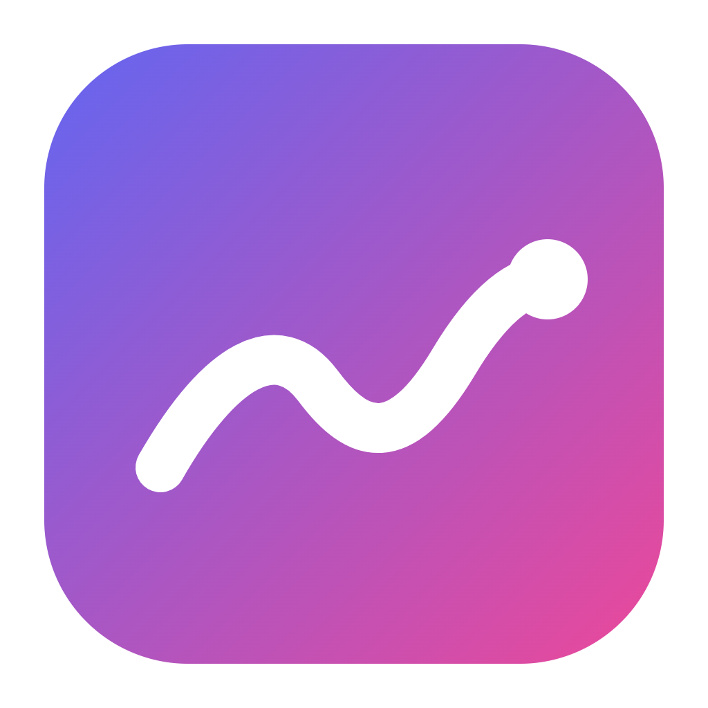
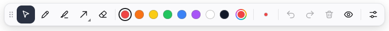
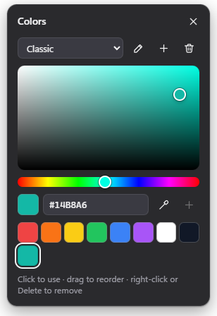
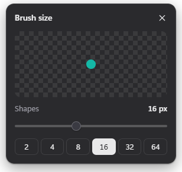
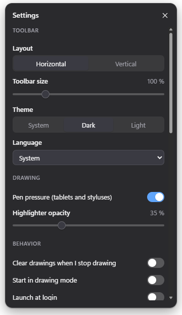
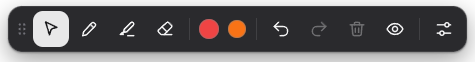

<p align="center">
  
</p>

<h1 align="center">Pen Overlay</h1>

<p align="center">
  Draw anywhere on your screen, on top of any app, with a small toolbar that stays out of the way.<br />
  For presentations, screen sharing, tutorials, code reviews and quick explanations.
</p>

<p align="center">
  <picture>
    <source media="(prefers-color-scheme: dark)" srcset="docs/images/toolbar-dark.png" />
    
  </picture>
</p>

Pen Overlay puts a transparent drawing layer over every monitor. Pick the pen
and draw over whatever is on screen, whichever window has focus; pick the
mouse and everything underneath works as usual while your drawings stay
visible. It runs on Windows, macOS and Linux, needs no account and never
touches the network.

## Features

- **Draw over everything**: one transparent layer per monitor, above other
  windows and the taskbar (exclusive full-screen games excepted). Monitors
  with different scaling are handled.
- **Low latency, also on long strokes**: every pen sample is recorded the
  moment it arrives and painted with the next display frame, so the screen
  never falls behind however fast the pen reports; the line is extended a
  few milliseconds ahead along your movement so it stays under the pointer
  when you draw fast; finished strokes are added without repainting the
  rest.
- **Tools**: pen (with tablet pressure), highlighter, line, arrow,
  rectangle, ellipse, and an eraser that removes whole strokes. Hold
  <kbd>Shift</kbd> for straight angles, squares and circles. The eraser end
  of a stylus erases too.
- **Your colours**: a colour picker with hex input and screen eyedropper,
  plus any number of named palettes (up to 12, 16 colours each). Add,
  remove, drag to reorder, rename. The active palette sits on the toolbar;
  <kbd>1</kbd>–<kbd>9</kbd> pick from it.
- **Brush sizes** from 1 to 96 px, remembered separately for each tool.
- **Undo and redo** across all monitors, **clear**, and **hide drawings**
  without losing them.
- **Draggable toolbar**, horizontal or vertical, full or **compact**,
  scalable from 75 % to 200 %, light, dark or following the system.
- **Global shortcuts** you can change, so drawing starts from any app.
- **Your defaults**: save the current tool, colour and size as your default
  and choose whether Pen Overlay starts with them or with what you used
  last. Settings are stored per user and can be exported and imported.
- **Accessible**: everything works with the keyboard and a screen reader,
  respects high-contrast and reduced-motion settings, and the toolbar can be
  made twice as large. See [Accessibility](#accessibility).
- English and German.

<p align="center">
  
  
  
</p>

## Install

Download the file for your system from the
[latest release](https://github.com/bearylaw/tool-pen-overlay/releases/latest).

| System | File | Notes |
|---|---|---|
| Windows 10/11 | `pen-overlay-<version>-win-x64.exe` (installer) or `…-windows-portable.exe` | Not code-signed yet: SmartScreen may say *Windows protected your PC*. Choose **More info → Run anyway**. Arm64 installer included. |
| macOS 11+ | `pen-overlay-<version>-mac-universal.dmg` | Not notarised yet: the first time, right-click the app → **Open** → **Open**. Lives in the menu bar, not the Dock. |
| Linux | `.AppImage` or `.deb` | Needs a compositing window manager for transparency. On Wayland, run under XWayland (default for Electron apps) for always-on-top to work. |

Each release lists SHA-256 checksums in `SHA256SUMS.txt`.

## Use

1. Start Pen Overlay. The toolbar appears at the top of your main screen and
   an icon appears in the system tray (menu bar on macOS).
2. Click the **pen** (or press <kbd>Ctrl</kbd>+<kbd>Alt</kbd>+<kbd>D</kbd> from
   any app) and draw.
3. Click the **mouse pointer** or press <kbd>Esc</kbd> to use your computer
   normally again. Your drawings stay until you clear or hide them.

Drag the toolbar by its handle (the dots at its start). Closing it is
done with **Hide toolbar** in settings or the shortcut; the tray icon brings
it back.

### Toolbar

| Button | Does |
|---|---|
| Mouse pointer | Stop drawing; clicks go to the apps underneath |
| Pen, Highlighter, Eraser | Pick the tool and start drawing |
| Shapes | Pick the shape tool; click again (or right-click) to choose line, arrow, rectangle or ellipse |
| Colour dots | The active palette; click one to use it, right-click for the colour picker |
| Rainbow ring | Colour picker and palette editor |
| Size dot | Brush size; scroll over it to change the size quickly |
| Undo, Redo, Clear | Across all monitors |
| Eye | Hide or show drawings without deleting them |
| Sliders | Settings |

### Compact toolbar

**Settings → Toolbar → Style → Compact** keeps only the essentials: mouse,
pen, highlighter, eraser, the first two colours of the active palette,
undo, redo, clear, hide drawings and settings.

<p align="center">
  
</p>

Reorder the palette to choose which two colours appear. Right-click either
colour (in both styles) to open the colour picker and palettes; shapes and
brush size stay on the keyboard (<kbd>S</kbd>, <kbd>[</kbd> <kbd>]</kbd>).

### Keys while drawing

These work while the toolbar or a panel has focus, which is the case while
you draw.

| Key | Does |
|---|---|
| <kbd>P</kbd> <kbd>H</kbd> <kbd>S</kbd> <kbd>E</kbd> | Pen, highlighter, shapes, eraser |
| <kbd>L</kbd> <kbd>A</kbd> <kbd>R</kbd> <kbd>O</kbd> | Line, arrow, rectangle, ellipse (oval) |
| <kbd>1</kbd>–<kbd>9</kbd> | Colours of the active palette |
| <kbd>[</kbd> <kbd>]</kbd> or <kbd>−</kbd> <kbd>+</kbd> | Smaller, larger brush |
| <kbd>Ctrl</kbd>+<kbd>Z</kbd> / <kbd>Ctrl</kbd>+<kbd>Y</kbd> (<kbd>⌘Z</kbd> / <kbd>⇧⌘Z</kbd>) | Undo / redo |
| <kbd>Delete</kbd> | Clear all drawings |
| <kbd>Esc</kbd> | Stop drawing (or close the open panel) |
| <kbd>Shift</kbd> while drawing | Straight line from the start point; 15° steps, squares, circles |

Letter and digit keys follow their physical position, so they work on any
keyboard layout.

### Global shortcuts

These work in every app and can be changed in **Settings → Global shortcuts**
(click a field, press the new combination; <kbd>Esc</kbd> cancels,
<kbd>Backspace</kbd> removes it). A shortcut another app already uses is
marked so you can pick a different one. On macOS, <kbd>Ctrl</kbd> is
<kbd>⌘</kbd> and <kbd>Alt</kbd> is <kbd>⌥</kbd>.

| Default | Does |
|---|---|
| <kbd>Ctrl</kbd>+<kbd>Alt</kbd>+<kbd>D</kbd> | Start or stop drawing |
| <kbd>Ctrl</kbd>+<kbd>Alt</kbd>+<kbd>H</kbd> | Show or hide drawings |
| <kbd>Ctrl</kbd>+<kbd>Alt</kbd>+<kbd>T</kbd> | Show or hide the toolbar |
| <kbd>Ctrl</kbd>+<kbd>Alt</kbd>+<kbd>C</kbd> | Clear all drawings |
| <kbd>Ctrl</kbd>+<kbd>Alt</kbd>+<kbd>Z</kbd> / <kbd>Y</kbd> | Undo / redo |

### Colours and palettes

Open the colour panel with the rainbow ring.

- Drag in the square and the hue bar, type a hex code, or use the eyedropper
  to take a colour from anywhere on screen.
- **+** adds the current colour to the palette.
- Drag swatches to reorder them; right-click (or focus and press
  <kbd>Delete</kbd>) to remove one; <kbd>Shift</kbd>+<kbd>←</kbd>/<kbd>→</kbd>
  moves the focused swatch.
- The palette menu switches palettes; the buttons beside it rename, add and
  delete palettes. The palette shown on the toolbar is the one selected here.

### Settings

| Section | What you can change |
|---|---|
| Toolbar | Full or compact style, horizontal or vertical layout, size (75–200 %), theme, language |
| Drawing | Pen pressure on or off, highlighter opacity |
| Behaviour | Clear drawings when you stop drawing, start in drawing mode, launch at login (Windows, macOS) |
| Defaults | Start with the last used tool or with your saved defaults; save the current tool, colour and size as your default |
| Global shortcuts | See above |
| Settings file | Export to and import from a JSON file (for a second computer or to share palettes), reset everything |

Settings belong to your user account and are kept in your user
configuration folder:

| System | Folder |
|---|---|
| Windows | `%APPDATA%\Pen Overlay\` |
| macOS | `~/Library/Application Support/Pen Overlay/` |
| Linux | `~/.config/Pen Overlay/` |

`settings.json` is plain JSON and safe to edit while the app is closed; a
value that does not make sense falls back to its default without touching
the rest. If the file cannot be read at all, it is kept as
`settings.broken-<time>.json` and the app starts with defaults.

## Accessibility

- Every control is a real button with a name, state (`aria-pressed`,
  `aria-expanded`, `aria-checked`) and, where one exists, its keyboard
  shortcut. The colour square and hue bar are sliders that work with the
  arrow keys (<kbd>Shift</kbd> for larger steps).
- <kbd>Tab</kbd> moves through the toolbar and panels with a visible focus
  ring; <kbd>Esc</kbd> closes panels; segmented controls use the arrow keys.
- **Toolbar size** goes up to 200 %, and panels scale with it.
- Windows **high contrast** and other forced-colour modes use system
  colours; **reduced motion** turns off all transitions.
- Tooltips name each button and its shortcut.
- Colour swatches are announced with their hex value; the selected one is
  marked by a ring, not by colour alone.
- Interface text is available in English and German and follows the system
  language unless set otherwise.

Something that does not work for you is a bug: please
[open an issue](https://github.com/bearylaw/tool-pen-overlay/issues/new/choose).

## Privacy

Pen Overlay makes no network connections, has no telemetry and does not
capture your screen. Drawings live in memory only and are gone when the app
quits. The only files it writes are its settings and a small log.

## Troubleshooting

- **Version**: run the app with `--version`, or look at the bottom of the
  settings panel.
- **Log**: `logs/main.log` in the settings folder above (rotated at 1 MB).
  Attach it to bug reports.
- **A shortcut does nothing**: another app holds it; settings mark it as
  taken. Choose another combination.
- **The toolbar is gone**: press <kbd>Ctrl</kbd>+<kbd>Alt</kbd>+<kbd>T</kbd>
  or click the tray icon. If it was on a monitor that is no longer connected,
  it moves back onto a connected one.
- **Linux: black instead of transparent**: enable your desktop's compositor.

## Develop

Prerequisites: [Node.js](https://nodejs.org/) 22 or newer (24 LTS
recommended) and npm. Optional for git hooks:
[lefthook](https://github.com/evilmartians/lefthook) and
[gitleaks](https://github.com/gitleaks/gitleaks).

```bash
npm ci
npm run electron:fetch
npm run dev
```

`npm ci` runs no install scripts (see [.npmrc](.npmrc)), so
`electron:fetch` downloads the Electron binary explicitly. Set
`PEN_OVERLAY_USER_DATA` to a folder to run with separate settings.

```bash
npm run check
```

Runs the type checker, Biome (format and lint), the architecture rules and
the unit tests; CI runs the same command. `npm run test:e2e` drives the
built app end to end and `node scripts/bench.mjs` measures input delay and
frame times on a long stroke (both need a desktop session); `npm run dist`
builds installers for the current system. Build and test detail for contributors
and agents is in [AGENTS.md](AGENTS.md); design decisions are in
[docs/decisions/](docs/decisions/).

### Layout

```
src/
  shared/      pure logic for every process: settings, commands, ink, keys, i18n
  main/        Electron main process: windows, tray, shortcuts, settings file
  preload/     the typed bridge between pages and the main process
  renderer/
    overlay/   the drawing layer, one per monitor
    toolbar/   the draggable toolbar
    panel/     colour, size, shape and settings panels
    ui/        theme, icons and helpers the pages share
resources/     icons
scripts/       build, icon rendering, end-to-end smoke test
docs/          decision records, images
```

## Contributing

Issues and pull requests are welcome; see [CONTRIBUTING.md](CONTRIBUTING.md).
Security problems: see [SECURITY.md](SECURITY.md).

## Licence

MIT, see [LICENSE](LICENSE).
